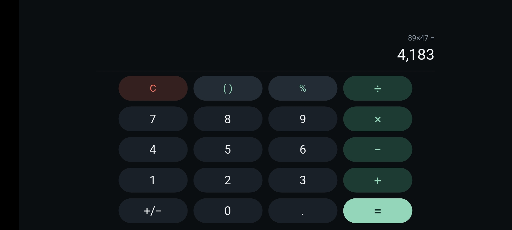
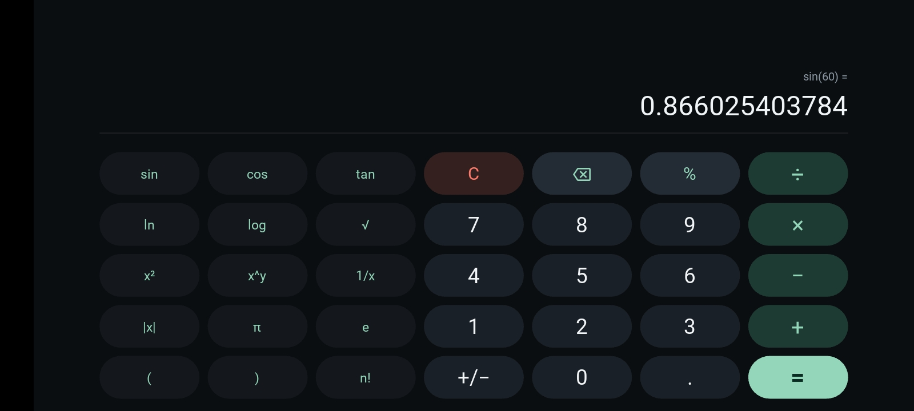
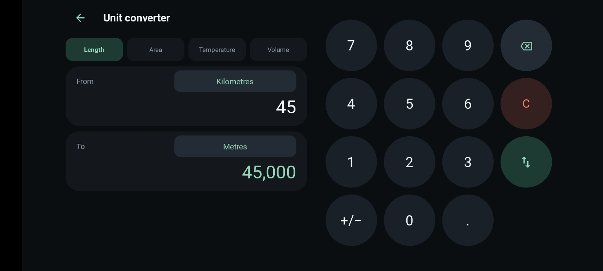

# Calculator App (showcase)

A dark-themed calculator for desktop and Android, written in Python with Kivy and KivyMD. Standard and scientific calculation, a history of past calculations and a unit converter live in one application.

> **The source code is private.** This repository holds the documentation, architecture, screenshots and a short illustrative snippet. See [LICENSE](LICENSE).

**Status:** Completed · **Stack:** Python 3.9+, Kivy, KivyMD, `decimal`, JSON, `unittest`

## Screenshots

| Standard | Scientific | Unit converter |
|---|---|---|
|  |  |  |

## What it does

- **Standard screen:** live result preview, percent that behaves like a real calculator (100 + 10% gives 110), smart brackets, thousands separators, sign toggle.
- **Scientific screen:** sin, cos, tan, ln, log, square root, square, powers, reciprocal, absolute value, factorial, π and e, with a DEG/RAD switch. It shares the expression with the Standard screen, so you can switch screens mid-calculation.
- **History:** the last 100 calculations, saved between launches; tap one to load it back for editing.
- **Unit converter:** length, area, temperature and volume, with a swap button and negative temperatures.
- **Desktop keyboard support:** digits, operators, brackets, Enter or `=`, Backspace, Delete or Esc.

## The problem it solves

Calculation, scientific functions and unit conversion each have their own logic. The challenge was keeping those pieces in one place so the finished program works as one product. The project began as a single large file with calculation, formatting, layout and navigation tangled together. It was audited and rebuilt so that the calculation engine and the screens are separate.

## Design in one paragraph

The core package never imports Kivy, and the UI package never contains calculation logic. A screen sends a key name to a shared session object and displays the text that comes back. See [docs/architecture.md](docs/architecture.md) for the diagram and module map.

## Key decisions

- **No `eval`.** Expressions are read by a parser written for the project, so typed input cannot run code. A test covers hostile input.
- **Exact arithmetic.** Python's `Decimal` is used, so 0.1 + 0.2 is exactly 0.3.
- **Typed errors.** Division by zero or a maths-domain error carries a message shown under the display, and the expression stays editable.
- **Grouping only when drawing.** Thousands separators are added for display only, so the stored expression never contains commas (see [snippets](snippets/group_thousands.py)).
- **Data, not repeated markup.** Keypad layouts are data; adding a unit is one line in the converter tables.

## Problems found and fixed

- Results were formatted with commas and written back into the expression, so every follow-up calculation failed.
- Percent was inserted as the modulo operator, so `50%` was a syntax error.
- The original called `eval`, which is not a sandbox.
- Leading zeros, a second decimal point, repeated operators and the sign toggle all acted on the wrong thing; each key now acts only on the number being typed.
- A module-level global kept in step by hand between screens was replaced by one session object.
- A crash when tapping a unit button was traced to a fragile dialog widget; dialogs were rebuilt on plain Kivy modal views.
- A second sweep fixed edge cases such as pressing `=` twice and powers or percent after a scientific-notation result, each with a regression test.

## Testing and evidence

- **65 unit tests** cover the calculation engine and need no Kivy installed.
- The audit could not launch the Kivy and KivyMD screens in the environment where it was written. The finished application has since been installed and run, and it works as intended.
- The layout is designed for portrait orientation, and the project is set up for a Buildozer build to Android.

## Source access

The code is private. I am happy to walk through it or demonstrate the app on request.
