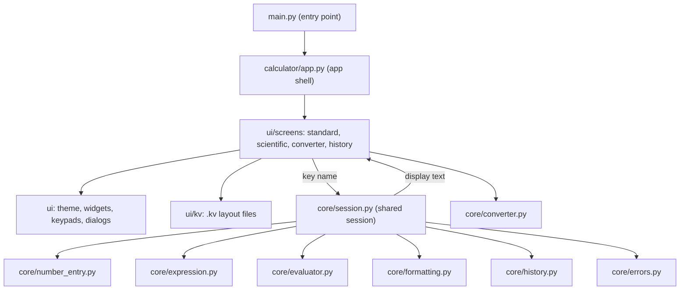

# Calculator App: architecture

**Rule:** `calculator/core` never imports Kivy; `calculator/ui` never contains calculation logic. A screen sends a key name to the shared session and shows the text that comes back.



## Layout of the project

```
main.py                  entry point
requirements.txt
calculator/
  app.py                 application shell
  core/                  pure Python, no Kivy
    session.py           shared state used by every screen
    expression.py        editing the expression
    number_entry.py      rules for the number being typed
    evaluator.py         parser and evaluation (no eval)
    formatting.py        display formatting
    history.py           last 100 calculations, saved as JSON
    converter.py         unit tables and conversion
    errors.py            typed errors with user messages
  ui/                    Kivy and KivyMD only
    theme.py  widgets.py  keypads.py  dialogs.py
    kv/                  standard, scientific, converter, history, widgets
    screens/             base, standard, scientific, converter, history
tests/                   engine tests (converter, evaluator, expression, formatting, session)
docs/                    audit and milestone notes
```

## Why it is split this way

- The engine can be tested without a GUI, which is why the 65 unit tests run without Kivy installed.
- Standard and Scientific share one session, so the expression survives a screen switch.
- Keypads are data, so a layout change does not mean editing logic.
